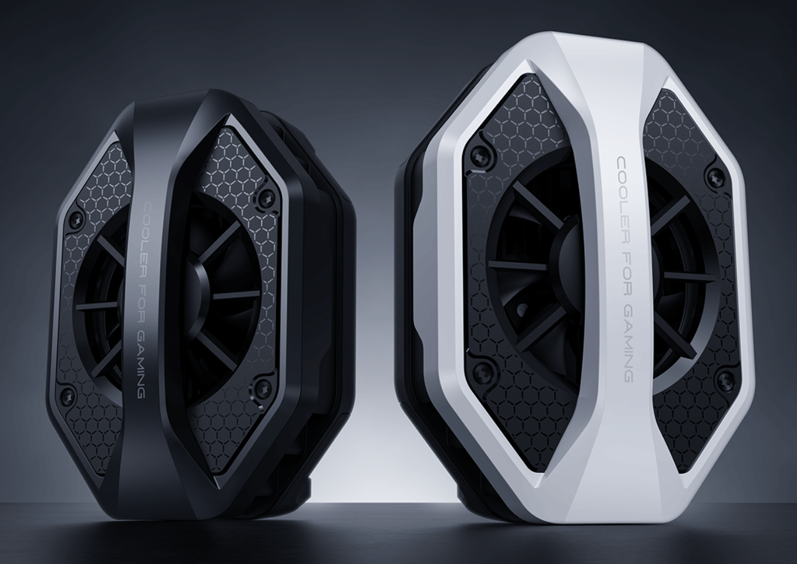
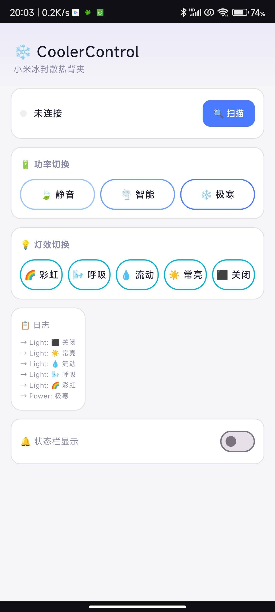
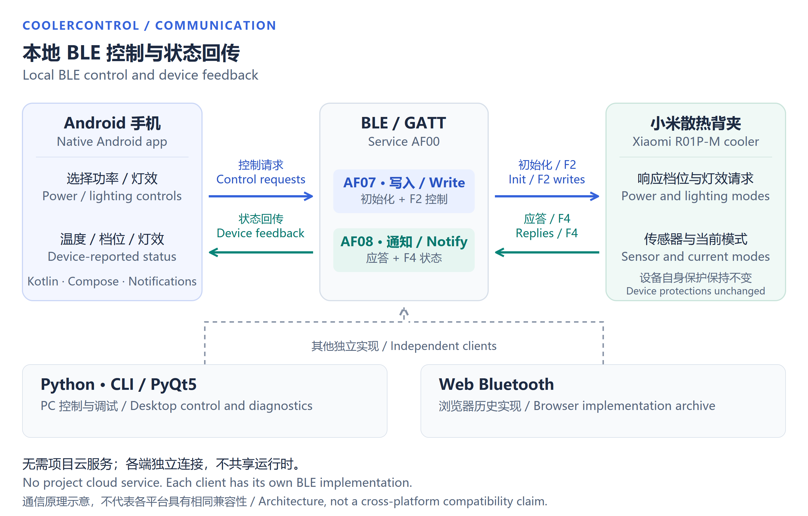
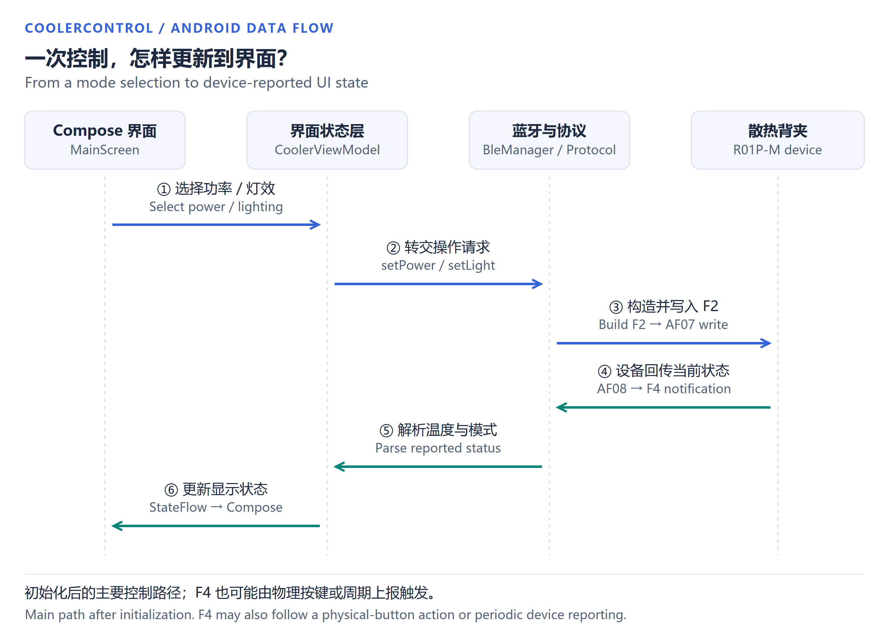

# CoolerControl ❄️

[简体中文](README.md) · **English**

**You bought the cooler. Your phone is missing a convenient way to control it.**

CoolerControl provides an independent BLE control interface for Xiaomi R01P-M owners using **Xiaomi / Redmi phones without HyperOS, or Android phones from other brands**. It does not rely on HyperOS's native device-control panel.

I built it by analyzing Bluetooth HCI captures and checking device behavior against the physical button. I now use the Android app on my own phone to change cooling and lighting modes, read device status, and access notification shortcuts.

[Download Android APK](https://github.com/vincent886-zq/Cooling-Fan-R01P-M-Third-party-control-software/releases/latest) · [Download source](https://github.com/vincent886-zq/Cooling-Fan-R01P-M-Third-party-control-software/archive/refs/heads/main.zip) · [Install and build](docs/USAGE.en.md) · [Protocol](docs/PROTOCOL.en.md) · [Development story](docs/DEVELOPMENT.en.md)

## The problem: a working device, but no suitable control interface

Powering the cooler and getting it to cool is not the same as having convenient access to all of its controls. Outside the relevant HyperOS environment, users may lack a suitable entry point for power modes, lighting and status—or find the available integration inconvenient.

The issue is not that these phones lack Bluetooth. It is the **fit between the device protocol and the available system interface**. I wanted people who already own the cooler to have a clear, direct interface on their current phone, rather than need another phone or a system-specific panel just to change modes.

The intended audience is Android users who own an R01P-M and need an independent interface. Phone and firmware compatibility still needs to be checked; this does not mean every non-HyperOS device is incapable of using an existing tool.

## Check the cooler model first

[Xiaomi product page](https://www.mi.com/shop/buy/detail?product_id=19492&cfrom=search) · [Front-view reference](docs/images/cooler-product-front.png)

These promotional product references help identify the device, with Xiaomi's product page as the reference source. Product designs and trademarks belong to their respective rights holders. These are not app screenshots or photographs I took of my own hardware.

The project started with BLE service discovery and communication experiments. I then analyzed HCI captures of normal operation, cross-checked the physical button, and iterated on the interface until I had the Android app I use today. The repository also preserves the Python desktop tools and a Web Bluetooth implementation from that process.

## The Android interface

  

An original screenshot from my Android phone, taken while disconnected. It shows the power and lighting controls, operation log and notification toggle.

## Everyday features

| Feature | What it does |
| --- | --- |
| Scan and connect | List device names, addresses and RSSI; select your cooler to connect or disconnect |
| Three power modes | Silent, Smart and Extreme |
| Five lighting modes | Rainbow, Breathing, Flowing, Steady and Off |
| Device status | Receive the cooler's reported temperature, power mode and lighting mode |
| Physical-button synchronization | Update the display from device reports, rather than only remembering the last tapped button |
| Operation log | Inspect connection messages and power / lighting operations |
| Notification shortcuts | Display status, cycle power or lighting, and toggle the light |

The phone communicates with the cooler over local BLE. I do not need a separate project cloud service, account backend or subscription. Notification behavior depends on the phone's notification permissions, foreground-service support and background restrictions.

## How control and feedback work

Blue arrows show outgoing requests; green arrows show device feedback. Python and Web are independent implementations, not modules inside the Android app.

[Open the high-resolution SVG](docs/images/communication-overview.svg)

The following sequence shows the main Android interaction path. Reported device state returns through notifications, rather than relying solely on an optimistic display change after a button tap.

[Open the high-resolution SVG](docs/images/android-command-feedback.svg)

## APK and source downloads

### Install the Android app

The [v1.0.0 release](https://github.com/vincent886-zq/Cooling-Fan-R01P-M-Third-party-control-software/releases/tag/v1.0.0) provides:

- **`CoolerControl-v1.0.0-debug.apk`**: the Android package, approximately 9.5 MB.
- **`CoolerControl-v1.0.0-source.zip`**: the source snapshot matching that release tag.
- **`SHA256SUMS.txt`**: checksums for the downloads.

Power the cooler, enable Bluetooth and the required permissions, scan for your device, and connect before operating it. See the [usage guide](docs/USAGE.en.md) for detailed steps.

The APK is **debug-signed**, not signed for an app store. Android may reject an in-place update if an older installation uses a different certificate; do not uninstall data you need without backing it up. The source configuration sets Android 8.0 / API 26 as the minimum and SDK 35 as the target. Actual compatibility still depends on the phone and device firmware.

### Explore the implementation

| Entry point | Technologies and source |
| --- | --- |
| Android app | Kotlin, Jetpack Compose, Android BluetoothGatt; [`app/src/main`](app/src/main) |
| PC GUI | Python, PyQt5, asyncio, Bleak; [`xiaomi_cooler_gui.py`](xiaomi_cooler_gui.py) |
| PC controller / CLI | Scanning, connection, commands, status and diagnostics; [`cooler_ctrl.py`](cooler_ctrl.py) |
| Browser archive | Web Bluetooth and JavaScript; [`cooler_web.html`](cooler_web.html) |

Android is my current everyday client. Python and Web have their own environments and implementation details. The archived Web version's initialization gate issue is documented in the [usage guide](docs/USAGE.en.md#4-web-bluetooth).

**The release source archive is a fixed snapshot; the main branch includes later documentation updates.** Changes to the project description or diagrams do not change the APK or application logic.

## What I worked on

- **Finding the communication path.** Enumerating GATT services and characteristics, then identifying AF07 for writes and AF08 for incoming data.
- **Understanding normal operations.** Separating authentication exchanges, initialization, property writes and unsolicited notifications in HCI captures.
- **Checking protocol mappings.** Comparing physical-button actions and device behavior, correcting the power-mode mapping, and recording five little-endian lighting values and signed temperature decoding.
- **Turning the findings into usable tools.** Organizing a Python control core and desktop tools, then implementing a separate native Android app and notification shortcuts.
- **Improving daily interaction.** Iterating on the device list, status cards, connected-state layout, logs and shortcut controls.

The [development story](docs/DEVELOPMENT.en.md) explains the modules and corrected assumptions. The [protocol notes](docs/PROTOCOL.en.md) document UUIDs, frame structures and value tables.

## Current use and compatibility

I use the app successfully on my own Android phone for the power and lighting controls I need. I have not tested every combination of phone, Android version and cooler firmware. For issue reports, include your system and device details, reproduction steps and a redacted log.

On my current unit, I have checked the phone-side Bluetooth controls offered for the product: power and lighting modes can be switched through this independent interface, although its UI differs from the original panel. I have also used a USB Type-C power meter for hardware checks. The meter checks relate to power control; lighting is checked from the device's visible behavior. Specific wattages, meter accuracy and complete measurement traces have not been published here.

Temperature is reported by the cooler, not the phone's processor. This project does not modify firmware or remove hardware power limits. Captured fixed initialization sequences are not a universal Xiaomi authentication algorithm.

## More

- [Installation, execution and builds](docs/USAGE.en.md)
- [BLE protocol and value tables](docs/PROTOCOL.en.md)
- [Development story and source map](docs/DEVELOPMENT.en.md)
- [v1.0.0 release notes](docs/RELEASE_NOTES_v1.0.0.en.md)
- [My mechanical engineering and automation portfolio](https://github.com/vincent886-zq/Mechanical-Engineering-Portfolio)
- [My research instrumentation and control software](https://github.com/vincent886-zq/Research-Instrumentation-Control)

## Support the project

If CoolerControl has helped you and you would like to leave a tip, you can buy me a coffee ☕

Support is entirely optional. No payment is required to download or use the software. Stars, bug reports and compatibility feedback are equally appreciated. Thank you!

Show WeChat Pay QR code

  

Scan with WeChat. If you are viewing this on the same phone, save the image and select it from the album in WeChat's scanner. Verify the recipient before paying.

This is an unofficial personal project I maintain. It is not affiliated with or endorsed by Xiaomi. The repository retains its original MIT declaration; third-party dependencies remain subject to their own licenses.

[vincent886-zq](https://github.com/vincent886-zq)
