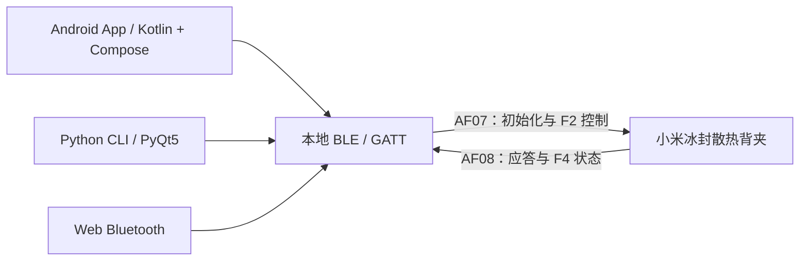

# CoolerControl ❄️

**小米冰封散热背夹 R01P-M · 第三方 Android BLE 控制软件**

Xiaomi Cooling Fan — third-party Android control app, with Python and Web Bluetooth implementations.

不只是控制界面：这是一个从实际使用需求出发，通过手机蓝牙 HCI 抓包、GATT 服务分析和设备物理按键核对，逐步实现第三方控制的个人项目。

[下载 Android APK](https://github.com/vincent886-zq/Cooling-Fan-R01P-M-Third-party-control-software/releases/latest) · [下载 / 查看源码](https://github.com/vincent886-zq/Cooling-Fan-R01P-M-Third-party-control-software/tree/main/app/src/main) · [使用与构建](docs/USAGE.md) · [协议说明](docs/PROTOCOL.md) · [开发过程](docs/DEVELOPMENT.md)

## 为什么做这个项目？

买了散热背夹，却因手机品牌或系统环境不能方便使用原有控制入口。我的目标很直接：**用自己的 Android 手机切换散热档位和灯效，并能看到设备状态。**

项目使用手机与散热背夹之间的本地 BLE 通信，不依赖本项目之外的自建云服务、账号后台或付费订阅。它不是小米官方应用，也不把特定设备的抓包重放描述成通用认证破解。

**作者已在自己的 Android 手机上正常使用，并确认日常所需的散热器控制功能可用。** 这属于作者的实机使用记录，不表示所有手机、系统或设备固件都已兼容测试。

## Android 真实界面

  

截图为作者提供的原始手机画面，未重绘 UI、修改文字或伪造曲线。**截屏时显示“未连接”**，用于展示界面布局；日志里的操作条目不单独作为命令已被硬件执行的证明。

## 能做什么？

| 功能 | Android 当前实现 |
| --- | --- |
| 设备发现 | BLE 扫描、设备名称 / 地址 / RSSI 列表、已配对设备提示 |
| 连接与断开 | 连接选定设备、发现服务和特征、订阅通知并发送初始化帧 |
| 三档功率 | 静音、智能、极寒 |
| 五种灯效 | 彩虹、呼吸、流动、常亮、关闭 |
| 状态显示 | 解析设备 F4 通知中的温度、功率和灯效 |
| 物理按键同步 | 通过设备上报的状态更新界面，不只显示 App 最近点过的按钮 |
| 操作日志 | 查看连接过程和功率 / 灯效操作信息 |
| 通知栏入口 | 显示温度、功率、灯效；循环切换功率、切换灯效、开关灯 |

通知栏需要系统允许通知与前台服务；不同 Android 系统的权限和后台限制不同。更多说明见 [使用指南](docs/USAGE.md)。

## 安装包与源码

### 直接使用 Android 版

打开 [Releases](https://github.com/vincent886-zq/Cooling-Fan-R01P-M-Third-party-control-software/releases)，下载 `CoolerControl-v1.0.0-debug.apk`。

1. 在自己的 Android 手机上安装，按系统提示允许来源安装。
2. 给散热背夹供电，开启手机蓝牙，授予应用所需权限。
3. 点击“扫描”，选择自己的散热背夹，等待连接初始化。
4. 切换功率、灯效，观察设备实际反应和回传状态。

这是**个人使用的 debug 签名 APK**，不是应用商店生产签名包。如已安装版本的签名不同，Android 可能拒绝覆盖安装；不要为此直接删除仍需保留的数据。源码最低 Android 配置为 API 26（Android 8.0），不代表全部 API 26–35 设备都经过测试。

### 查看或复现源码

- 发布页提供同版本源码压缩包和 SHA-256 校验文件。
- Android 主入口：[MainActivity.kt](app/src/main/java/com/coolercontrol/MainActivity.kt)。
- PC 图形界面：[xiaomi_cooler_gui.py](xiaomi_cooler_gui.py)，控制核心：[cooler_ctrl.py](cooler_ctrl.py)。
- 浏览器实现：[cooler_web.html](cooler_web.html)。这是独立的 Web Bluetooth 实现，不是 Android APK 的网页外壳。

详细环境、构建命令、Python 启动方式和浏览器限制见 [USAGE.md](docs/USAGE.md)。

## 我在这个项目里做了什么？

1. **分析设备通信入口。** 枚举 BLE 服务与特征，区分写入通道、通知通道和不能直接使用的候选特征。
2. **分析官方操作产生的 HCI 抓包。** 对比连接初始化、认证交互、属性写入与设备主动上报，而不是把“BLE 写入成功”直接等同于功能执行成功。
3. **核对控制值与状态。** 对照设备物理按键和操作记录，修正功率映射，确认灯效的两字节小端编码，解析有符号温度。
4. **实现多端入口。** 先整理 Python CLI / PyQt 控制工具和浏览器页面，再形成 Kotlin / Compose Android 应用。
5. **做日常使用交互。** 增加状态卡片、连接后收起设备列表、功率与灯效按钮、日志，以及通知栏快捷控制。

开发阶段使用过 WorkBuddy 等 AI 编程辅助工具进行分析和实现；项目中的设备操作、需求确认及物理按键对照按实际记录说明，不把工具辅助生成的分析自动视作已经验证的事实。

## 软件结构

三个入口复用的是协议认识，并不是共用同一份运行时实现。一个平台能用，不自动代表另外两个平台也通过了本次实机验证。

| Android 模块 | 作用 |
| --- | --- |
| [CoolerProtocol.kt](app/src/main/java/com/coolercontrol/CoolerProtocol.kt) | UUID、初始化帧、功率 / 灯效编码及 F4 状态解析 |
| [BleManager.kt](app/src/main/java/com/coolercontrol/BleManager.kt) | 扫描、连接、服务发现、通知和 GATT 写入 |
| [CoolerViewModel.kt](app/src/main/java/com/coolercontrol/CoolerViewModel.kt) | 状态流、扫描列表、日志和 UI 事件 |
| [MainScreen.kt](app/src/main/java/com/coolercontrol/MainScreen.kt) | Compose 控制界面 |
| [CoolerService.kt](app/src/main/java/com/coolercontrol/CoolerService.kt) | 通知栏前台服务与快捷操作 |
| [NotificationActionReceiver.kt](app/src/main/java/com/coolercontrol/NotificationActionReceiver.kt) | 全局状态和快捷动作辅助逻辑；当前通知按钮通过 Service PendingIntent 分发 |

## 关键协议认识

- 主服务 `AF00`，命令写入 `AF07`，通知接收 `AF08`。
- `F2` 用于属性控制，`F4` 用于接收设备状态。
- 功率：静音 `0x0001`、智能 `0x0000`、极寒 `0x0002`。
- 灯效为两字节小端值，例如流动 `03 01`、关闭 `00 00`。
- 历史抓包中的 c0 / c1 交互需要区分；**当前源码仍保留固定 c0 / c1 初始化序列**，不是动态实现所有设备的认证算法。

完整字段、值表及历史结论边界见 [协议说明](docs/PROTOCOL.md)。

## 实际验证与适用范围

| 内容 | 依据与范围 |
| --- | --- |
| Android 手机上正常使用 | 作者明确确认；未公开具体手机型号、Android 版本和固件矩阵，不补造这些信息 |
| 界面与操作入口 | 上方真实手机截图，以及对应 Kotlin / Compose 源码 |
| 功率 / 灯效映射 | 当前源码及后期物理按键核对记录；不能沿用早期报告中已被修正的映射 |
| 连接、认证与帧格式 | 本地开发记录与历史 HCI 抓包分析；没有上传完整手机抓包 |
| Python / Web | 附对应源码及历史开发资料；不标成与 Android 同范围的本轮实机验证 |

本项目控制设备已有的档位和灯效，**不修改固件、不解除硬件功率限制，也不承诺降温幅度、功率测量值或全机型兼容**。温度是设备上报值，不是另行标定后的手机芯片温度。

## English summary

CoolerControl is a third-party BLE controller for the Xiaomi R01P-M cooling accessory. It was developed from a practical compatibility need through GATT inspection, Bluetooth HCI capture analysis and physical-button checks. The repository contains a native Kotlin / Jetpack Compose Android app, Python CLI / PyQt tools, and a Web Bluetooth implementation.

The Android app offers three power modes, five lighting modes, device-reported status, operation logs and notification shortcuts. The author reports normal use on their own Android phone; this is not a claim of universal device / firmware compatibility. The screenshot is an original phone capture taken while disconnected. Download the debug-signed APK and matching source from [Releases](https://github.com/vincent886-zq/Cooling-Fan-R01P-M-Third-party-control-software/releases).

## 相关作品与声明

- [机械设计与机电自动化作品集](https://github.com/vincent886-zq/Mechanical-Engineering-Portfolio)
- [科研仪器采集与控制软件](https://github.com/vincent886-zq/Research-Instrumentation-Control)

三组作品独立维护，本仓库只展示散热背夹第三方控制项目。非官方项目，与小米无隶属或背书关系。许可沿用原 README 的 MIT 声明；第三方依赖分别遵循其自身许可。

作者：[vincent886-zq](https://github.com/vincent886-zq)
